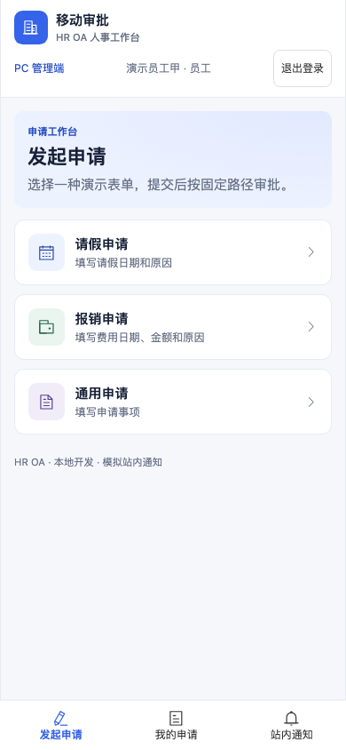
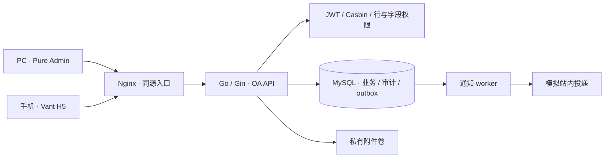

<!-- HR OA project README, rewritten 2026-11-07. Original GVA README is preserved in README.gin-vue-admin.md. -->
# HR OA · 人事与办公协同系统

[](https://github.com/skyfrostz/HR_OA/actions/workflows/ci.yaml)

面向人事档案、劳动合同和内部审批的模块化单体应用。PC 管理端基于 **Pure Admin**，手机审批端基于 **Vant H5**，共用 Go API、MySQL 与统一账号权限模型。

[快速启动](#快速启动) · [功能与交付状态](#功能与交付状态) · [系统架构](#系统架构) · [开发与验证](#开发与验证) · [运维与数据保护](#运维与数据保护) · [文档导航](#文档导航) · [许可与来源](#许可与来源)

> **当前阶段：M1–M3 本地开发验收完成。** 已验证真实 MySQL、PC/H5 业务流程及隔离备份恢复，使用的均为模拟资料。企业微信和阿里云 OSS 已选型，尚未接入；当前版本不代表生产交付完成。
>
> **许可提示：** 本仓库保留的 gin-vue-admin 固定版本采用 **BSL 1.1**，不是 Apache-2.0。该组件的生产使用限制见 [LICENSE](LICENSE)；商业或生产交付前须核实上游授权。Pure Admin 的独立 MIT 许可证见 [web-pure-admin/LICENSE](web-pure-admin/LICENSE)。

## 界面预览

### PC 人事管理


### 手机审批



截图来自 2026-11-07 的本地浏览器验收。当前页面使用真实业务 API；演示账号和截图中的员工资料仅用于开发测试。

## 功能与交付状态

| 领域 | 已实现能力 | 使用边界 |
| --- | --- | --- |
| 组织与档案 | 部门层级、员工新增/编辑、服务端搜索与部门筛选、分页、工号、出生日期、动态年龄、入职日期、动态工龄、约定工资 | 版本检查避免覆盖并发修改；工资由服务端执行字段权限 |
| 年假台账 | 按年登记额度、已用量和备注，支持半天粒度 | 人工记录，不自动计算法定额度，不自动随审批扣减 |
| 劳动合同 | 多份历史合同、状态与期限、续约关联、私有附件上传和鉴权下载 | 支持 PDF/JPEG/PNG；开发环境使用本地私有卷 |
| 到期提醒 | 已逾期及未来 1–90 天到期查询、有效续约排除、合同跳转 | 按上海日历计算；当前为页面查询，尚无企业微信定时推送 |
| Excel | 模板下载、逐行预览与错误反馈、整批确认、按已应用筛选授权导出 | 仅新增员工；导入最多 1000 行/2 MiB，导出最多 5000 条授权记录 |
| 顺序审批 | 请假、报销、通用申请；发起、待办、已办、通过、驳回、转交和重提 | 演示流程固定为负责人 → 复核；正式表单与路径需客户确认 |
| 审批可靠性 | 幂等重试、并发状态检查、事务审计、outbox 和通知失败重试 | 当前通知为模拟站内投递，不代表真实企业消息 |
| 访问控制 | 统一身份、路径/方法授权、员工行权限、工资字段权限、附件权限 | 前端隐藏按钮不替代后端鉴权 |
| 数据恢复 | 数据库与私有附件成对备份、校验和、独立环境恢复读回 | 本机演练已通过，异地保留策略和生产容灾尚未验收 |

## 系统架构



后端遵循 `Router → API → Service → Model` 分层。OA 专用入口为 `server/cmd/oa`，业务接口前缀为 `/api/oa/v1`，响应遵循 `{ code, data, msg }`。保留的上游初始化、代码生成、插件与示例代码不等于 OA 运行时注册这些能力。

PC 使用 `web-pure-admin/` 中真实的布局、菜单、标签、路由和主题体系；H5 保留在 `web/` 中独立构建。组合镜像发布 Pure 的 `oa.html`/`pure-assets/` 和 Vant 的 `h5.html`/`assets/`，两端通过同源 API 访问相同数据。

### 技术与版本

| 层次 | 技术与固定基线 |
| --- | --- |
| 后端 | Go、Gin、GORM、Casbin；构建镜像 Go 1.26.4，模块约束以 `server/go.mod` 为准 |
| PC | Pure Admin v7.0.0、Vue 3、TypeScript、Element Plus、Pinia、Vite；pnpm 10.32.1 |
| H5 | Vue 3、Vant、Vite；独立 npm 锁文件 |
| 数据与导表 | MySQL 8.4.8、Excelize v2.9.0 |
| 交付 | Docker Compose、Node 24.15.0 构建镜像、Nginx 1.28.0 |
| 验证 | Go tests/race、Vitest、Playwright Chromium、真实 MySQL 并发测试 |

## 快速启动

需要 Git、运行中的 Docker Engine/Desktop、Docker Compose v2 或更新版本，以及 Python 3。使用下列 Compose 流程时，无需在宿主机安装 Go、Node 或 MySQL。

```bash
git clone https://github.com/skyfrostz/HR_OA.git
cd HR_OA
bash scripts/oa-dev.sh init
bash scripts/oa-dev.sh up
```

首次 `init` 会生成随机本地数据库密码、JWT 密钥和开发账号密码，保存到权限为 `0600` 的 `.env`。该文件不入库；重复执行保留已有内容。首次构建需要下载镜像和依赖。

| 入口 | 地址 |
| --- | --- |
| PC 人事管理 | http://127.0.0.1:8080/oa.html |
| 手机审批 | http://127.0.0.1:8080/h5.html |
| 健康检查 | http://127.0.0.1:8080/api/oa/v1/health |
| 本地 MySQL 调试 | `127.0.0.1:13306` |

API 仅在 Compose 内网监听 8888，经 Nginx 提供同源访问。默认栈仅绑定本机回环地址。

### 开发账号与权限

密码为本机 `.env` 中的 `OA_SEED_PASSWORD`，仓库不提供固定公共密码。

| 账号 | 角色 | 档案与合同范围 | 写入与工资 |
| --- | --- | --- | --- |
| `hr_admin` | 人事管理员 | 全部员工 | 可维护部门、员工、年假、合同及导入；可见工资 |
| `hr_viewer` | 人事查阅员 | 全部员工 | 只读；响应与导出均省略工资 |
| `employee` | 员工 | 本人 | 可见本人工资；发起申请 |
| `manager` | 审批人 | 本人档案及分配给自己的审批任务 | 演示负责人节点 |
| `finance` | 审批人 | 本人档案及分配给自己的审批任务 | 演示复核节点 |
| `delegate` | 审批人 | 本人档案及分配给自己的审批任务 | 演示转交对象 |

PC 与 H5 独立登录，令牌仅保存在内存，刷新后需重新登录。重复启动不会重置数据库中的账号密码；修改 `.env` 也不会自动修改已有账号或数据库卷的密码。

### 首次体验

1. 在 PC 使用 `hr_admin` 建立部门和员工，维护合同、附件及年度年假。
2. 下载 Excel 模板，先查看预览与逐行错误，再确认导入；查看合同到期提醒。
3. 在 H5 使用 `employee` 发起申请，由 `manager` 处理第一步、`finance` 处理第二步。
4. 使用 `hr_viewer` 或 `employee` 检查只读、工资和本人范围的差异。

## 配置说明

| 配置项 | 用途 | 当前默认方式 |
| --- | --- | --- |
| `OA_DB_PASSWORD` / `OA_DB_ROOT_PASSWORD` | 开发数据库凭据 | 由 `init` 随机生成 |
| `OA_JWT_SECRET` | JWT 服务端签名密钥 | 由 `init` 随机生成 |
| `OA_SEED_PASSWORD` | 开发种子账号密码 | 由 `init` 随机生成 |
| `OA_DEV_SEED` | 是否启用开发种子 | 当前 Compose 设置为 `true` |
| `OA_MYSQL_DSN` | API 数据库连接 | Compose 根据本地凭据组装 |
| `OA_STORAGE_DIR` | 私有附件目录 | API 容器内 `/var/lib/oa/private` |
| `OA_MOCK_NOTIFY_FAIL` | 模拟通知故障 | 默认 `false`，仅用于开发验收 |

企业微信和 OSS 凭据尚无已启用的配置接口，不应自行添加前端 `VITE_*` 密钥。后续接入所需配置和边界见 [外部集成状态](docs/INTEGRATION_STATUS.md)。

## 开发与验证

### 目录结构

```text
.
├── server/cmd/oa/         # OA 专用启动入口
├── server/oa/             # 业务模型、服务、接口、路由与测试
├── web-pure-admin/        # Pure Admin 源码与 PC 业务页
├── web/src/h5/            # Vant 手机审批
├── web/src/oa/            # 原 PC 业务实现与回归基线
├── tests/                # API、并发、浏览器与恢复验证
├── scripts/              # 本地启动、验收及备份恢复
├── deploy/oa/            # Nginx 与隔离恢复配置
├── docs/                 # 契约、验证、来源和使用说明
├── Dockerfile            # API、Pure、H5 多阶段构建
└── compose.yaml          # 本地开发栈
```

### 本地检查

```bash
# 后端：在 server/ 执行
go test -mod=readonly ./oa/...
go test -mod=readonly -race ./oa/...
go build -mod=readonly -o /tmp/hr-oa ./cmd/oa

# PC：在 web-pure-admin/ 执行
npx --yes pnpm@10.32.1 install --frozen-lockfile --ignore-scripts
npx --yes pnpm@10.32.1 run test
npx --yes pnpm@10.32.1 run typecheck
npx --yes pnpm@10.32.1 run build

# H5 与原业务回归：在 web/ 执行
npm ci --no-audit --no-fund
npm run test:oa
npm run build:oa
```

`typecheck` 检查实际 OA 生产入口可达的 TypeScript/Vue 文件；保留但未注册的上游演示源码存在旧接口类型诊断，不能将本项目的生产入口检查描述为整个上游示例树检查通过。迁入的 JavaScript 沿用 `checkJs: false`。

根目录 GitHub Actions 工作流检查上述后端、PC 和 H5 构建/测试，不执行部署。它不替代真实数据库、浏览器或恢复演练；当前 CI 结果以仓库 Actions 页面为准。

2026-11-07 首次发布的 [CI 42322714206](https://github.com/skyfrostz/HR_OA/actions/runs/42322714206) 中，后端与 H5 通过，Pure 的登录后侧栏等待断言失败（3/4 测试通过），类型检查及构建因前序失败被跳过。后续本地修复已通过 Pure 5/5 测试、生产入口类型检查和构建，并补充独立 CI 诊断；本轮发布包含这些修复，远端验证结果以对应提交的 Actions 运行记录为准。详见[商业交付审查](docs/COMMERCIAL_REVIEW.md)。

### 端到端验收

2026-11-07 的本地验收覆盖角色即时变更/禁用、越权访问、工资隔离、附件格式与大小边界、并发版本写入、导入原子性和幂等重试、审批转交与重提、通知失败恢复、容器重建以及隔离备份恢复。

- [M1 验证](docs/VALIDATION.md)
- [M2 验证](docs/VALIDATION_M2.md)
- [Pure Admin 与 M3 验证](docs/VALIDATION_M3.md)

`tests/` 下的验收会写入模拟数据，部分脚本还会短暂改变测试账号权限或重建容器。`tests/results/` 中的状态文件、浏览器环境和升级前快照是相关脚本的前置条件，不随仓库分发。请按 [运行说明](docs/LOCAL_DEVELOPMENT.md) 和 [部署/验收说明](deploy/oa/README.md) 在专用开发环境执行，勿对实际业务库运行这些场景。

## 运维与数据保护

### 日常操作

```bash
docker compose ps
curl --fail http://127.0.0.1:8080/api/oa/v1/health
bash scripts/oa-dev.sh stop
# 再次启动，保留既有数据
bash scripts/oa-dev.sh up
```

数据库和私有附件分别使用命名卷 `hr-oa_mysql-data`、`hr-oa_private-files`。停止容器保留数据；不要将不同时间点的数据库与附件目录混用。

### 备份与隔离恢复

```bash
archive="$(bash scripts/oa-backup.sh backup)"
# 需要先完成相应验收并取得已知样本状态文件
bash scripts/oa-backup.sh restore "$archive" \
  tests/results/oa-state.json \
  tests/results/m2/oa-m2-state.json \
  tests/results/m3/state.json
```

备份短暂停止 API 写入与通知 worker，在同一暂停期间保存数据库和私有文件，然后恢复 API。归档默认保存在忽略目录 `.local/backups/`，目录权限 `0700`、文件权限 `0600`，包含校验和及对应 API 镜像 ID。

恢复命令创建独立临时数据库和附件目录，验证记录 ID、版本、字段与附件摘要，完成后清理隔离容器。它不会覆盖活动数据卷，也不等于已有生产级异地备份、加密保留或灾备切换方案。

### 当前安全边界

- 服务端按角色、员工行范围和字段检查权限，私有附件必须鉴权下载。
- 工资权限针对结构化字段及 Excel 导出。查阅员仍可下载授权范围内的合同附件；若原合同包含工资，其原文不会自动脱敏。跨所有渠道的工资保密需要另行设计附件分级或脱敏副本。
- 令牌不存入浏览器持久化存储，不放入 URL；敏感响应使用 `no-store`。
- OA 入口采用明确路由范围，上游示例、初始化和代码生成端点未开放。
- 开发账号、随机密钥、数据库内容、附件和测试结果不提交到仓库。
- 生产交付前仍需完成许可核实、真实身份接入、正式审批策略、TLS/密钥管理、依赖安全审查、监控及恢复目标验收。

详见 [安全基线](docs/SECURITY_BASELINE.md)。发现疑似漏洞时，请避免在公开 Issue 中附带真实资料或凭据。

## 后续接入

| 项目 | 已确定方向 | 剩余工作 |
| --- | --- | --- |
| 企业平台 | 企业微信 | 客户应用配置、成员映射、免登与明确接收人的消息联调 |
| 云附件 | 阿里云 OSS 私有桶 | 服务端凭据、权限配置、附件完整性迁移及鉴权下载联调 |
| 审批策略 | 简单顺序审批 | 客户确认正式表单、字段和审批路径 |
| 生产交付 | 待单独验收 | 许可、部署、密钥、监控、备份保留与恢复目标 |

## 文档导航

| 文档 | 内容 |
| --- | --- |
| [本地开发](docs/LOCAL_DEVELOPMENT.md) | 账号、入口、运行及验证方式 |
| [M3 使用说明](docs/M3_USER_GUIDE.md) | 部门、年假、导入和到期提醒操作 |
| [基础 API](docs/OA_API_CONTRACT.md) | 身份、员工、合同和附件契约 |
| [审批 API](docs/M2_API_CONTRACT.md) | 顺序状态机、幂等与通知契约 |
| [M3 API](docs/M3_API_CONTRACT.md) | 版本编辑、Excel 和提醒契约 |
| [商业交付审查](docs/COMMERCIAL_REVIEW.md) | 实际 UI/源码对比、首批修复验收、生产交付差距与后续顺序 |
| [商业审查接口增量](docs/COMMERCIAL_REVIEW_API.md) | 已本地验收的员工搜索与同条件导出约定 |
| [Pure 集成](docs/PURE_ADMIN_INTEGRATION.md) | 固定上游、改动和双入口构建 |
| [发布记录](docs/PUBLICATION.md) | 首次仓库发布、许可说明纠正及历史证据边界 |

## 许可与来源

本项目包含不同来源、分别授权的代码。根目录 [LICENSE](LICENSE) 完整保留固定 GVA 源码的 **BSL 1.1** 文本及授权方信息。目标仓库初始化时的 Apache-2.0 文本保留为 [LICENSE-HR-OA](LICENSE-HR-OA)，该文本不替代或解除第三方组件条款。不能把整个仓库统一标记为 Apache-2.0 或 MIT。

| 来源 | 固定版本 / 提交 | 保留内容 |
| --- | --- | --- |
| [gin-vue-admin](https://github.com/flipped-aurora/gin-vue-admin) | `v2.9.2-stable` / `a6882210a80bb27e3aa5dff0b4c21aa4afe8988a` | [BSL 1.1](LICENSE)、[原始中文 README](README.gin-vue-admin.md)、[原始英文 README](README-en.md)、源代码与署名 |
| [Vue Pure Admin](https://github.com/pure-admin/vue-pure-admin) | `v7.0.0` / `b8177a202dceb1412d3bf56f3d15483dc1606c9c` | [MIT](web-pure-admin/LICENSE)、完整导入源码、[原始哈希](docs/PURE_ADMIN_UPSTREAM_SHA256SUMS)和[改动清单](docs/PURE_ADMIN_CHANGES.md) |

GVA 原始文档要求保留版权与署名，并提供[商业授权入口](https://plugin.gin-vue-admin.com/license)。具体使用范围以对应版本的许可证及获得的授权为准。感谢上述项目及其依赖的贡献者。
