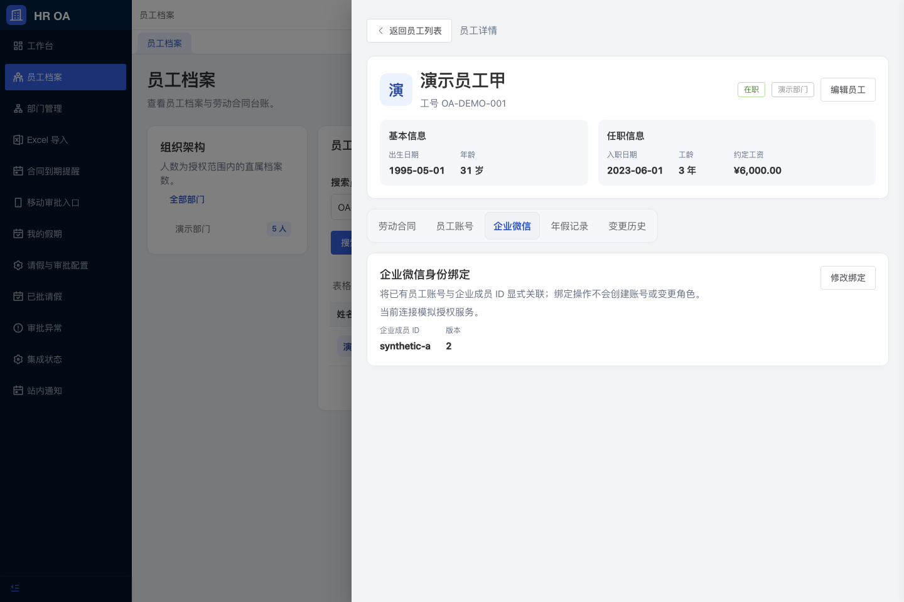
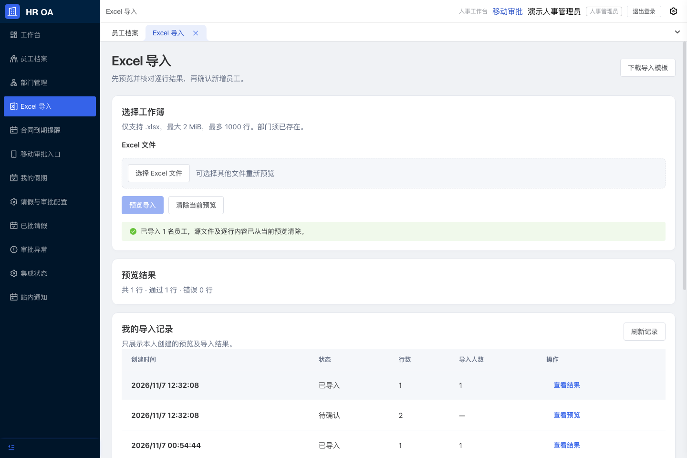
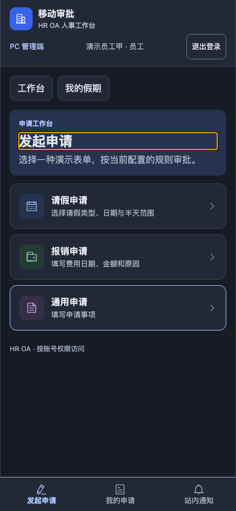
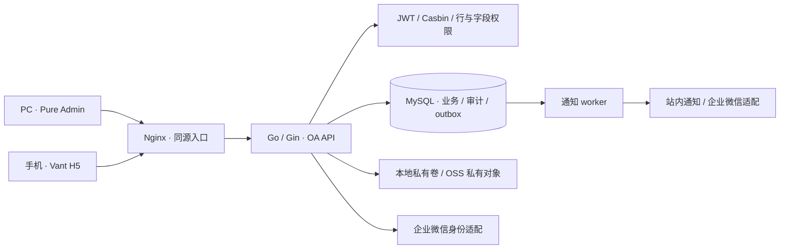

<!-- HR OA project README, rewritten 2026-11-07. Original GVA README is preserved in README.gin-vue-admin.md. -->
# HR OA · 人事与办公协同系统

[](https://github.com/skyfrostz/HR_OA/actions/workflows/ci.yaml)

面向人事档案、劳动合同和内部审批的模块化单体应用。PC 管理端基于 **Pure Admin**，手机审批端基于 **Vant H5**，共用 Go API、MySQL 与统一账号权限模型。

[快速启动](#快速启动) · [功能与交付状态](#功能与交付状态) · [系统架构](#系统架构) · [开发与验证](#开发与验证) · [运维与数据保护](#运维与数据保护) · [文档导航](#文档导航) · [许可与来源](#许可与来源)

> **当前阶段：M1–M6 既定开发功能与模拟联调已完成。** 已补齐企业微信、OSS、合同定时通知、附件分级预览、导入历史与运维能力，并通过本地 MySQL、浏览器和隔离恢复验收。用户确认外部资源尚未准备，真实企业/云环境验收未开展；当前版本不代表生产上线完成。逐项证据见 [功能验收索引](docs/FEATURE_ACCEPTANCE_MATRIX.md)。
>
> **许可提示：** 本仓库保留的 gin-vue-admin 固定版本采用 **BSL 1.1**，不是 Apache-2.0。该组件的生产使用限制见 [LICENSE](LICENSE)；商业或生产交付前须核实上游授权。Pure Admin 的独立 MIT 许可证见 [web-pure-admin/LICENSE](web-pure-admin/LICENSE)。

## 界面预览

### 企业身份与员工档案



### 导入历史与敏感资料清理



### 手机授权与审批工作台



截图来自 2026-11-07 M6 组合镜像的本地浏览器验收。[更多浅深色与窄屏截图](docs/VALIDATION_M6.md#实际页面截图)。页面使用真实 OA API；企业授权和 OSS 连接本地模拟服务，演示账号和员工资料仅用于开发测试。[M4 人事与组织页面](docs/VALIDATION_M4.md#实际页面截图)及 [M5 假期与审批页面](docs/VALIDATION_M5.md#实际页面截图)保留历史验证记录。

## 功能与交付状态

| 领域 | 已实现能力 | 使用边界 |
| --- | --- | --- |
| 组织与档案 | 部门树及直属人数、Pure 表格列/密度/分页/全屏、档案侧滑详情、服务端搜索、工号、出生日期、年龄、入职日期、工龄、约定工资 | 版本检查避免覆盖并发修改；工资由服务端执行字段权限 |
| 员工账号 | 开通/绑定、员工与审批人角色、密码重置、启停、离职及当前/未来待办交接 | 保护管理账号和本人账号；旧会话持续撤销；本轮不含返聘 |
| 业务变更历史 | 工资、部门、年假、合同、账号与在职状态的前后值、操作者及原因 | 与业务同事务；工资事件按授权排除；不虚构历史记录 |
| 请假与余额 | 可配置类型、周工作日及日期例外、半天和跨年预览；提交预占、批准扣减、驳回/撤回释放、撤销冲回 | 人工已用与审批已用分开，扣额度类型共用年度年假台账；不自动计算法定额度或结转，旧申请不追溯扣款 |
| 劳动合同 | 草稿编辑、签署登记、终止、续约关联、定点查询、普通/敏感附件、受控图片/PDF预览和鉴权下载 | 版本与状态检查；签署登记不等于电子签章；支持本地私有卷和 OSS 适配 |
| 到期提醒 | 已逾期及未来 1–90 天查询、有效续约排除、合同跳转；可开启定时站内/企业提醒 | 上海日历；定时通知默认关闭，开启后按合同版本/阈值/收件人去重，真实企业发送需配置 |
| Excel | 模板、逐行预览、仅错误行与错误文件下载、到期清理、整批确认、历史结果和筛选授权导出 | 仅新增员工；导入最多 1000 行/2 MiB，导出最多 5000 条授权记录；历史按创建者隔离 |
| 顺序审批 | PC/H5 请假、报销、通用申请；发起、待办、已办、通过、驳回、转交、重提、撤回和催办；管理员异常交接及撤销已批新版请假 | 按类型、直属部门、报销金额和优先级配置 1–10 个顺序步骤；历史保留原规则，无匹配时用负责人 → 复核演示路径 |
| 审批可靠性 | 幂等重试、并发状态检查、事务审计、outbox 和受控重试 | 投递区分模拟、API接受、失败和未知；未知结果不盲重投，接受不代表送达/已读 |
| 企业身份 | 企业微信 PC 扫码/桌面授权、H5 内授权、已有员工显式绑定、一次性登录票据 | 不自动建号或提权；默认禁用，真实企业资源待配置 |
| 工作台 | 当前角色待办、本人申请、合同到期和管理员异常计数，直达授权列表；本人余额和流水 | 真实 API 数据，不展示虚构趋势；H5 合同入口跳转 PC 管理端并独立登录 |
| 访问控制 | 统一身份、路径/方法授权、员工行权限、工资字段权限、附件权限 | 前端隐藏按钮不替代后端鉴权 |
| 数据恢复 | 成对备份、校验和、独立恢复、可移植运行镜像与恢复清单 | 真实异机恢复、云对象独立备份和生产容灾需另行验收 |

## 系统架构



后端遵循 `Router → API → Service → Model` 分层。OA 专用入口为 `server/cmd/oa`，业务接口前缀为 `/api/oa/v1`，响应遵循 `{ code, data, msg }`。保留的上游初始化、代码生成、插件与示例代码不等于 OA 运行时注册这些能力。

PC 使用 `web-pure-admin/` 中真实的布局、菜单、标签、路由和主题体系；H5 保留在 `web/` 中独立构建。组合镜像发布 Pure 的 `oa.html`/`pure-assets/` 和 Vant 的 `h5.html`/`assets/`，两端通过同源 API 访问相同数据。

### 技术与版本

| 层次 | 技术与固定基线 |
| --- | --- |
| 后端 | Go、Gin、GORM、Casbin；构建镜像 Go 1.26.4，模块约束以 `server/go.mod` 为准 |
| PC | Pure Admin v7.0.0、Vue 3、TypeScript、Element Plus、Pinia、Vite；pnpm 10.32.1 |
| H5 | Vue 3、Vant、Vite；独立 npm 锁文件 |
| 数据与导表 | MySQL 8.4.8、Excelize v2.9.0 |
| 交付 | Docker Compose、Node 24.15.0 构建镜像、Nginx 1.28.0 |
| 验证 | Go tests/race、Vitest、Playwright Chromium、真实 MySQL 并发测试 |

## 快速启动

需要 Git、运行中的 Docker Engine/Desktop、Docker Compose v2 或更新版本，以及 Python 3。使用下列 Compose 流程时，无需在宿主机安装 Go、Node 或 MySQL。

```bash
git clone https://github.com/skyfrostz/HR_OA.git
cd HR_OA
bash scripts/oa-dev.sh init
bash scripts/oa-dev.sh up
```

首次 `init` 会生成随机本地数据库密码、JWT 密钥和开发账号密码，保存到权限为 `0600` 的 `.env`。该文件不入库；重复执行保留已有内容。首次构建需要下载镜像和依赖。

| 入口 | 地址 |
| --- | --- |
| PC 人事管理 | http://127.0.0.1:8080/oa.html |
| 手机审批 | http://127.0.0.1:8080/h5.html |
| 健康检查 | http://127.0.0.1:8080/api/oa/v1/health |
| 本地 MySQL 调试 | `127.0.0.1:13306` |

API 仅在 Compose 内网监听 8888，经 Nginx 提供同源访问。默认栈仅绑定本机回环地址。

### 开发账号与权限

密码为本机 `.env` 中的 `OA_SEED_PASSWORD`，仓库不提供固定公共密码。

| 账号 | 角色 | 档案与合同范围 | 写入与工资 |
| --- | --- | --- | --- |
| `hr_admin` | 人事管理员 | 全部员工 | 可维护部门、档案、账号、年假、合同及导入；可见工资 |
| `hr_viewer` | 人事查阅员 | 全部员工 | 只读；响应与导出均省略工资 |
| `employee` | 员工 | 本人 | 可见本人工资；发起申请 |
| `manager` | 审批人 | 本人档案及分配给自己的审批任务 | 演示负责人节点 |
| `finance` | 审批人 | 本人档案及分配给自己的审批任务 | 演示复核节点 |
| `delegate` | 审批人 | 本人档案及分配给自己的审批任务 | 演示转交对象 |

PC 与 H5 独立登录，令牌仅保存在内存，刷新后需重新登录。重复启动不会重置数据库中的账号密码；修改 `.env` 也不会自动修改已有账号或数据库卷的密码。

### 首次体验

1. 在 PC 使用 `hr_admin` 建立部门和员工，维护合同、附件及年度年假。
2. 下载 Excel 模板，先查看预览与逐行错误，再确认导入；查看合同到期提醒。
3. 在“请假与审批配置”核对日历和类型；需要时设置顺序审批规则。默认日历为周一至周五，无内置法定节假日。
4. 在 PC 审批中心或 H5 使用 `employee` 发起申请。请假先预览半天计算与年度余额；未配置匹配规则时，由 `manager` 处理第一步、`finance` 处理第二步。
5. 在员工侧滑详情中切换合同、账号、年假及变更历史，或从“我的假期与流水”核对审批额度；账号管理只操作测试员工。
6. 使用 `hr_viewer` 或 `employee` 检查只读、工资和本人范围的差异。

## 配置说明

| 配置项 | 用途 | 当前默认方式 |
| --- | --- | --- |
| `OA_DB_PASSWORD` / `OA_DB_ROOT_PASSWORD` | 开发数据库凭据 | 由 `init` 随机生成 |
| `OA_JWT_SECRET` | JWT 服务端签名密钥 | 由 `init` 随机生成 |
| `OA_SEED_PASSWORD` | 开发种子账号密码 | 由 `init` 随机生成 |
| `OA_DEV_SEED` | 是否启用开发种子 | 当前 Compose 设置为 `true` |
| `OA_MYSQL_DSN` | API 数据库连接 | Compose 根据本地凭据组装 |
| `OA_STORAGE_DIR` | 私有附件目录 | API 容器内 `/var/lib/oa/private` |
| `OA_MOCK_NOTIFY_FAIL` | 模拟通知故障 | 默认 `false`，仅用于开发验收 |

企业微信、OSS、生产配置检查和附件迁移命令见 [M6 运维说明](docs/M6_OPERATIONS.md)。默认开发栈保留本地附件与模拟站内通知，不自动联系云服务；密钥仅在服务端私密环境配置，不能放进 `VITE_*`。客户资源状态见 [外部集成状态](docs/INTEGRATION_STATUS.md)。

## 开发与验证

### 目录结构

```text
.
├── server/cmd/oa/         # OA 专用启动入口
├── server/oa/             # 业务模型、服务、接口、路由与测试
├── web-pure-admin/        # Pure Admin 源码与 PC 业务页
├── web/src/h5/            # Vant 手机审批
├── web/src/oa/            # 原 PC 业务实现与回归基线
├── tests/                # API、并发、浏览器与恢复验证
├── scripts/              # 本地启动、验收及备份恢复
├── deploy/oa/            # Nginx 与隔离恢复配置
├── docs/                 # 契约、验证、来源和使用说明
├── Dockerfile            # API、Pure、H5 多阶段构建
└── compose.yaml          # 本地开发栈
```

### 本地检查

```bash
# 后端：在 server/ 执行
go test -mod=readonly ./oa/... ./cmd/oa
go test -mod=readonly -race ./oa/... ./cmd/oa
go build -mod=readonly -o /tmp/hr-oa ./cmd/oa

# PC：在 web-pure-admin/ 执行
npx --yes pnpm@10.32.1 install --frozen-lockfile --ignore-scripts
npx --yes pnpm@10.32.1 run test
npx --yes pnpm@10.32.1 run typecheck
npx --yes pnpm@10.32.1 run build

# H5 与原业务回归：在 web/ 执行
npm ci --no-audit --no-fund
npm run test:oa
npm run build:oa
```

`typecheck` 检查实际 OA 生产入口可达的 TypeScript/Vue 文件；保留但未注册的上游演示源码存在旧接口类型诊断，不能将本项目的生产入口检查描述为整个上游示例树检查通过。迁入的 JavaScript 沿用 `checkJs: false`。

根目录 GitHub Actions 检查后端、PC、H5，并独立启动真实 MySQL 与本地模拟提供商做集成测试，不执行部署。全新 checkout 可从仓库根目录执行 `bash scripts/oa-ci-integration.sh` 验证基础流程，追加 `--mock-providers` 执行与 CI 相同的企业微信/OSS 联调；无需已有 `.env` 或旧验收数据。CI 不替代客户环境、浏览器和恢复演练；当前结果以 Actions 页面为准。

M5 基线提交 `d2f2fa1` 已通过 [CI 42333448464](https://github.com/skyfrostz/HR_OA/actions/runs/42333448464)。M6 在原后端、Pure、H5 检查之外新增独立 MySQL 与模拟提供商集成任务；发布提交的状态见页首徽章与 [Actions 运行记录](https://github.com/skyfrostz/HR_OA/actions/workflows/ci.yaml)。历史失败与修复保留在[商业交付审查](docs/COMMERCIAL_REVIEW.md)及 [M4 验证记录](docs/VALIDATION_M4.md#发布后的-ci-修复)。

### 端到端验收

2026-11-07 的本地验收覆盖角色即时变更/禁用、越权访问、工资隔离、附件格式与大小边界、并发版本写入、导入原子性和幂等重试、审批转交与重提、通知失败恢复、容器重建以及隔离备份恢复。

- [M1 验证](docs/VALIDATION.md)
- [M2 验证](docs/VALIDATION_M2.md)
- [Pure Admin 与 M3 验证](docs/VALIDATION_M3.md)
- [M4 第一批验证](docs/VALIDATION_M4.md)
- [M5 请假与审批验证](docs/VALIDATION_M5.md)
- [M6 集成与功能收口验证](docs/VALIDATION_M6.md)

`tests/` 下的验收会写入模拟数据，部分脚本还会短暂改变测试账号权限或重建容器。`tests/results/` 中的状态文件、浏览器环境和升级前快照是相关脚本的前置条件，不随仓库分发。请按 [运行说明](docs/LOCAL_DEVELOPMENT.md) 和 [部署/验收说明](deploy/oa/README.md) 在专用开发环境执行，勿对实际业务库运行这些场景。

## 运维与数据保护

### 日常操作

```bash
docker compose ps
curl --fail http://127.0.0.1:8080/api/oa/v1/health
bash scripts/oa-dev.sh stop
# 再次启动，保留既有数据
bash scripts/oa-dev.sh up
```

数据库和私有附件分别使用命名卷 `hr-oa_mysql-data`、`hr-oa_private-files`。停止容器保留数据；不要将不同时间点的数据库与附件目录混用。

### 备份与隔离恢复

```bash
archive="$(bash scripts/oa-backup.sh backup)"
# 需要先完成相应验收并取得已知样本状态文件
bash scripts/oa-backup.sh restore "$archive" \
  tests/results/oa-state.json \
  tests/results/m2/oa-m2-state.json \
  tests/results/m3/state.json \
  tests/results/m4/api-state.json \
  tests/results/m5/browser-state.json
```

上例的 M3、M4、M5 状态参数为可选；仅在对应验收生成状态文件后传入。

备份短暂停止 API 写入与通知 worker，在同一暂停期间保存数据库和私有文件，然后恢复 API。归档默认保存在忽略目录 `.local/backups/`，目录权限 `0700`、文件权限 `0600`，包含校验和及对应 API 镜像 ID。

恢复命令创建独立临时数据库和附件目录，验证记录 ID、版本、字段与附件摘要，完成后清理隔离容器。它不会覆盖活动数据卷，也不等于已有生产级异地备份、加密保留或灾备切换方案。

M6 另提供无需历史测试 JSON 的可移植校验路径：

```bash
portable="$(bash scripts/oa-backup.sh pack "$archive")"
bash scripts/oa-backup.sh verify "$portable"
bash scripts/oa-backup.sh restore-check "$portable"
```

此包包含 API/MySQL 镜像、数据库、本地私有附件和独立清单，用于隔离恢复及数据摘要验证。Web 镜像、客户密钥、云端对象备份和生产 HTTPS 配置需单独交付；本机可移植演练不能称为真实异机切换完成。

### 当前安全边界

- 服务端按角色、员工行范围和字段检查权限，私有附件必须鉴权下载。
- 工资权限覆盖结构化字段、Excel 和敏感附件。新界面上传默认敏感级，查阅员不能读取其元数据、预览或下载；旧附件兼容保留普通级，若含工资原文应先核对并改为敏感级，系统不会自动识别或脱敏合同文字。
- 令牌不存入浏览器持久化存储，不放入 URL；敏感响应使用 `no-store`。
- OA 入口采用明确路由范围，上游示例、初始化和代码生成端点未开放。
- 开发账号、随机密钥、数据库内容、附件和测试结果不提交到仓库。
- 生产交付前仍需完成许可核实、真实身份接入、正式审批策略、TLS/密钥管理、依赖安全审查、监控及恢复目标验收。

详见 [安全基线](docs/SECURITY_BASELINE.md)。发现疑似漏洞时，请避免在公开 Issue 中附带真实资料或凭据。

## 后续接入

| 项目 | 已确定方向 | 剩余工作 |
| --- | --- | --- |
| 企业平台 | 企业微信 | 客户应用配置、成员映射、免登与明确接收人的消息联调 |
| 云附件 | 阿里云 OSS 私有桶 | 服务端凭据、权限配置、附件完整性迁移及鉴权下载联调 |
| 审批策略 | 版本化顺序规则与请假日历 | 客户确认正式额度、节假日、表单和审批人员；复杂分支/会签另行评估 |
| 生产交付 | 待单独验收 | 许可、部署、密钥、监控、备份保留与恢复目标 |

## 文档导航

| 文档 | 内容 |
| --- | --- |
| [本地开发](docs/LOCAL_DEVELOPMENT.md) | 账号、入口、运行及验证方式 |
| [功能验收索引](docs/FEATURE_ACCEPTANCE_MATRIX.md) | 既定功能与证据逐项对应，开发与客户环境边界 |
| [M6 范围与 API](docs/M6_SCOPE.md) | [身份、投递、附件和导入接口](docs/M6_API_CONTRACT.md) |
| [M6 操作说明](docs/M6_USER_GUIDE.md) | 导入历史、敏感附件、企业绑定、通知与到期提醒 |
| [M6 配置与维护](docs/M6_OPERATIONS.md) | 生产门禁、企业/OSS配置、迁移和最小权限模板 |
| [M6 来源核对](docs/M6_SOURCE_REUSE.md) | 官方协议、SDK 和 PDF 组件来源 |
| [M6 验证记录](docs/VALIDATION_M6.md) | 分层结果、失败修复、运行版本与真实截图 |
| [M5 操作说明](docs/M5_USER_GUIDE.md) | 请假预览、额度流水、顺序规则、撤回催办和异常处理 |
| [M5 API](docs/M5_API_CONTRACT.md) | 计算快照、预占与冲回、规则版本、异常交接和工作台 |
| [M5 设计与复用](docs/M5_UI_DESIGN.md) | 沿用 M4 的展示与交互；[实际源码复用](docs/M5_SOURCE_REUSE.md) |
| [M4 操作说明](docs/M4_USER_GUIDE.md) | 账号、合同生命周期、业务变更历史、PC 审批和组织名册 |
| [M4 API](docs/M4_API_CONTRACT.md) | 账号会话撤销、审批交接、合同流转、审计和筛选契约 |
| [M4 前端设计](docs/M4_UI_DESIGN.md) | 组件检索、实际选型、显示与交互原则 |
| [后续路线](docs/NEXT_PHASE_PLAN.md) | GitHub 源码评估及后续功能顺序 |
| [M3 使用说明](docs/M3_USER_GUIDE.md) | 部门、年假、导入和到期提醒操作 |
| [基础 API](docs/OA_API_CONTRACT.md) | 身份、员工、合同和附件契约 |
| [审批 API](docs/M2_API_CONTRACT.md) | 顺序状态机、幂等与通知契约 |
| [M3 API](docs/M3_API_CONTRACT.md) | 版本编辑、Excel 和提醒契约 |
| [商业交付审查](docs/COMMERCIAL_REVIEW.md) | 实际 UI/源码对比、首批修复验收、生产交付差距与后续顺序 |
| [商业审查接口增量](docs/COMMERCIAL_REVIEW_API.md) | 已本地验收的员工搜索与同条件导出约定 |
| [Pure 集成](docs/PURE_ADMIN_INTEGRATION.md) | 固定上游、改动和双入口构建 |
| [发布记录](docs/PUBLICATION.md) | 首次仓库发布、许可说明纠正及历史证据边界 |

## 许可与来源

本项目包含不同来源、分别授权的代码。根目录 [LICENSE](LICENSE) 完整保留固定 GVA 源码的 **BSL 1.1** 文本及授权方信息。目标仓库初始化时的 Apache-2.0 文本保留为 [LICENSE-HR-OA](LICENSE-HR-OA)，该文本不替代或解除第三方组件条款。不能把整个仓库统一标记为 Apache-2.0 或 MIT。

| 来源 | 固定版本 / 提交 | 保留内容 |
| --- | --- | --- |
| [gin-vue-admin](https://github.com/flipped-aurora/gin-vue-admin) | `v2.9.2-stable` / `a6882210a80bb27e3aa5dff0b4c21aa4afe8988a` | [BSL 1.1](LICENSE)、[原始中文 README](README.gin-vue-admin.md)、[原始英文 README](README-en.md)、源代码与署名 |
| [Vue Pure Admin](https://github.com/pure-admin/vue-pure-admin) | `v7.0.0` / `b8177a202dceb1412d3bf56f3d15483dc1606c9c` | [MIT](web-pure-admin/LICENSE)、完整导入源码、[原始哈希](docs/PURE_ADMIN_UPSTREAM_SHA256SUMS)和[改动清单](docs/PURE_ADMIN_CHANGES.md) |

GVA 原始文档要求保留版权与署名，并提供[商业授权入口](https://plugin.gin-vue-admin.com/license)。具体使用范围以对应版本的许可证及获得的授权为准。感谢上述项目及其依赖的贡献者。
