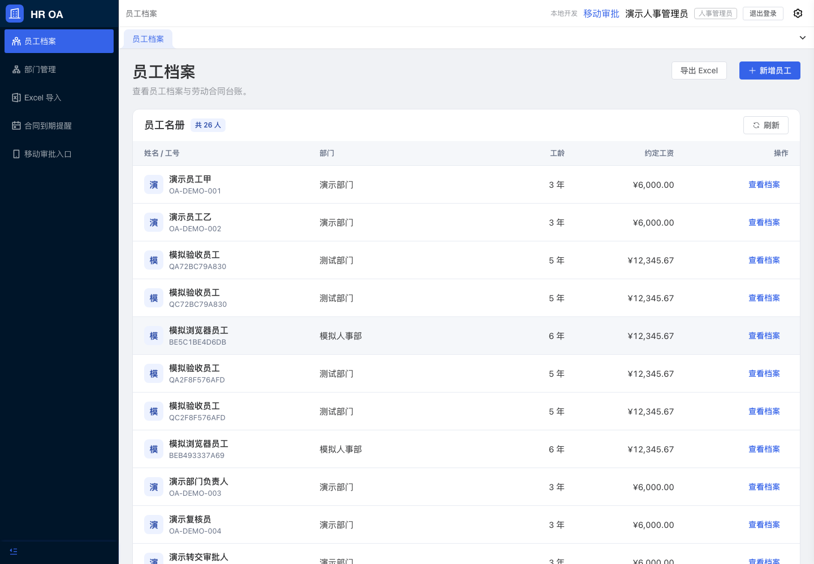
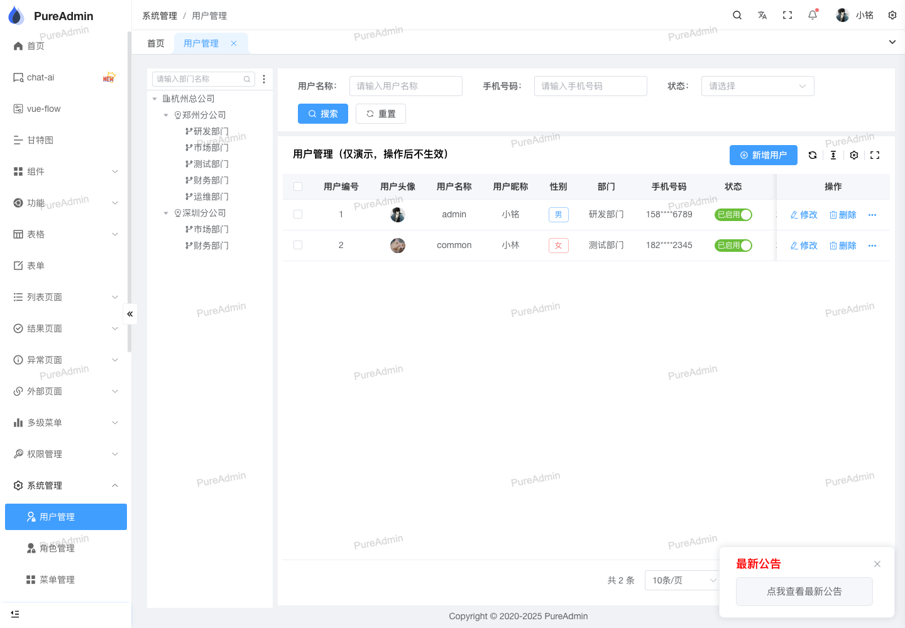
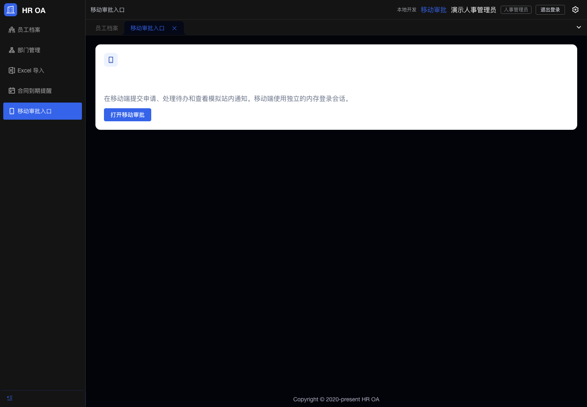
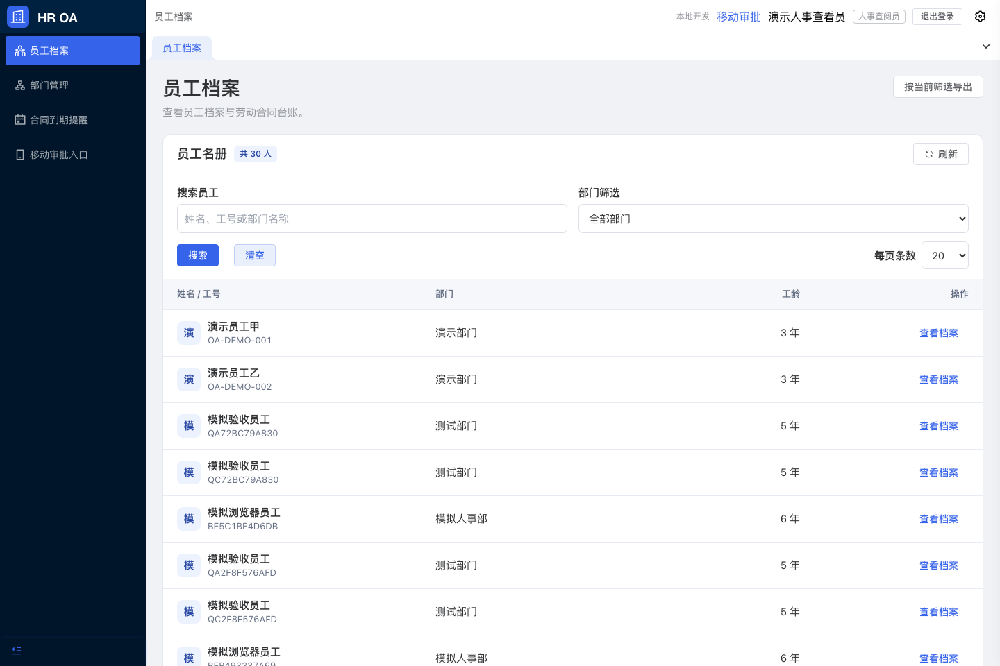
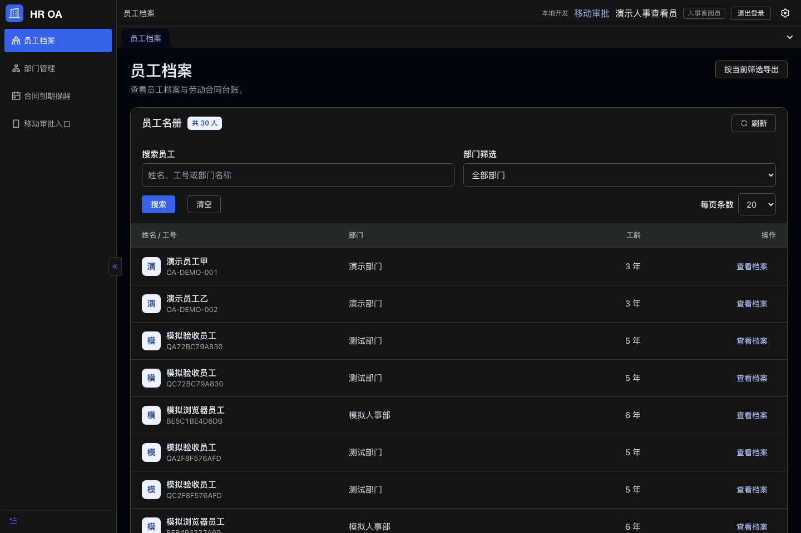
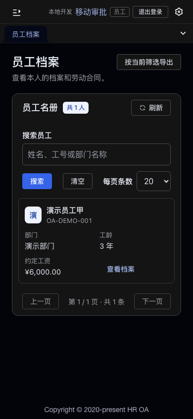

# HR OA 当前状态验收与商业交付深度审查

> 状态说明：本文保留本地审查收口时的结果，包括当时“未提交/未推送”的事实；用户随后已授权发布本轮修改并跑通 CI，后续进展见 [发布记录](PUBLICATION.md)。

审查日期：2026-11-07。基线：已发布 `main` 的 `84b9809cc226fca820714b47c373f1f54a3a0a56`。本轮补强为基线上的本地未提交修改。审查范围包括运行中的 PC/H5、Go 业务层、身份与权限、数据库事务、部署和恢复脚本、GitHub CI，以及实际上游页面和固定版本源码。

## 1. 验收结论

**当前是“核心流程已在本地验收的 HR OA 开发版本”，还不能作为客户生产交付完成。**

已有成果是实质实现：员工/合同/私有附件、四角色范围、两级审批及幂等事务、手工年假、部门、Excel 和本机成对备份恢复均有本地证据。商业缺口集中在许可、账号和合同生命周期、敏感修改审计、真实企业集成与运维能力，不是再加几个菜单就能补齐。

| 层面 | 审查开始时状态 | 判断依据 |
| --- | --- | --- |
| 本地核心功能 | 已验收 | M1/M2/M3 历史真实 MySQL、Chromium 与备份恢复报告；本轮检查三容器 healthy，健康接口真实 DB Ping 正常 |
| 历史证据绑定 | 基本一致 | M3 清单比当前基线仅5处发布说明/声明变化；PUBLICATION.md 已明确历史快照边界，未发现业务代码偏离验收快照 |
| GitHub CI | FAIL | [首次运行](https://github.com/skyfrostz/HR_OA/actions/runs/42322714206)：Go/H5成功；Pure安装成功，测试3/4，登录后等待布局失败；类型检查和构建被跳过 |
| 商业使用许可 | 未落实到项目证据 | GVA固定版本是BSL 1.1，当前没有适用商业授权凭证；Pure MIT不能覆盖后端条款 |
| WeCom / OSS | NOT CONNECTED / NOT TESTED | 仍为开发账号、本地私有文件、模拟站内投递，无客户应用、桶、凭据及HTTPS域名 |
| 生产上线与灾备 | NOT RUN | 无客户生产部署、外网TLS验收、异机恢复、生产负载和正式安全扫描证据 |

本轮新修改的验收单列于后文，不能把历史 PASS 直接延伸到尚未复验的修改。未做正式渗透测试或完整依赖漏洞扫描；代码审查没有证实跨员工读或重复审批绕过，不等于安全性已被完全证明。

## 2. 实际页面对比

本轮实际登录了本机1440px页面、切换浅/深主题；并打开 Pure 官方在线演示的首页、用户管理、部门管理。在线演示可能随上游更新，视觉观察不冒充固定v7.0.0的运行验收；固定版代码另按 `b8177a202dceb1412d3bf56f3d15483dc1606c9c` 核对。

Vben演示的动态模块加载失败；Soybean登录页能打开，但后续身份接口网络失败。两者仅核实官方仓库和可达页面，不声称已完整体验其业务工作台。本轮最充分的UI对照是Pure。

本机修改前的员工列表：

Pure官方用户管理页：

| 页面/能力 | 上游实际表现 | HR OA 差距及影响 | 优先处理 |
| --- | --- | --- | --- |
| 员工名册 | Pure有独立查询区、部门树、重置、密度/列设置、页大小与跳页 | 原页面只有刷新和固定20条；1000人最坏翻50页。较高行距让普通笔记本屏幕只容纳少量记录 | 本轮补真实服务器查询、部门筛选、页大小与筛选导出；后续统一表格工具栏与跳页 |
| 组织结构 | Pure有树表格与展开/折叠、搜索 | 当前虽有真实parentId/循环校验，页面仍是平铺表，上级只显示文字，缺少层级路径 | 增部门树、成员数量、有效上级候选，避免后代节点选完才被后端拒绝 |
| 移动审批入口 | Pure主题变量覆盖其标准组件 | 实测深色时卡片背景和标题均为 `rgb(255,255,255)`，标题不可见；不是主观审美问题 | 本轮修复并复验浅/深主题 |
| 部门编辑 | 员工表单已有导航保护 | 部门表单只在请求中/结果未知时锁定，普通编辑时切页、刷新会静默丢输入 | 本轮将编辑状态纳入保护，刷新不丢草稿 |
| H5待办/通知 | 工作流应用应能读到新待办 | 原H5只在挂载/翻页请求，同tab重复点击不加载，没有刷新入口；用户停留后新任务不出现 | 本轮增加可见刷新，保持分页与请求取消 |
| 合同到期队列 | 理想行为是打开那一份合同并高亮 | 目前只传employeeId并回合同第一页；目标在第2页时找不到。返回后筛选/位置也缺少恢复 | 后续内存传contractId、定点读取及返回状态恢复 |
| PC审批 | 桌面工作台通常有待办/已办和详情联动 | PC只有跳H5入口，且独立登录；重度审批人没有桌面批量浏览/筛选体验 | 后续复用现有审批API做桌面待办与详情，不重复开发审批规则 |
| Excel导入 | 商业工具应能快速定位错误 | 已有安全预览与确认，但缺仅看错误、错误行下载、预览到期提示和导入结果列表 | 先补错误定位与结果回看，再考虑异步大文件 |
| 窄屏/空态 | 当前390px已有历史验收 | 保留卡片式窄屏有价值；已有加载/错误/空态，不能误报“没有状态”。空态仍缺下一步操作 | 统一下一步入口；键盘可达与无障碍图标标签仍需专项检查 |

深色缺陷原始证据：

Pure不是仅换皮：本项目真实使用了上游布局、菜单、标签、主题和路由体系。但员工业务仍是手工HTML table，部门/导入/年假才使用pure-table。上游 `src/views/system/user/index.vue:55–170` 已有查询、部门树和 `PureTableBar`；本地 `src/components/RePureTableBar` 可直接复用。**工资无权列必须从columns中剔除，不能只hide**，因为上游列全选会把hide重置为false。

Pure的用户/部门演示页明确写着“仅演示，操作后不生效”。导入这些菜单不等于实现账号管理；也不应复制虚构图表、空菜单来增加功能数量。

## 3. 底层代码对比

### 3.1 与所采用的 GVA 固定版本

- 上游有 `server/service/system/sys_user.go` 的注册、改密、用户管理和角色授权，以及数据库Casbin策略；OA只复用身份模型/JWT等基础，运行入口刻意只注册OA白名单，四角色策略从源码构造。结果是暴露面可控，但客户不能自行开通用户、配置角色或维护数据范围。
- 上游系统路由使用 `OperationRecord`，OA没有启用它。不能简单补挂该中间件：固定版 `server/middleware/operation.go` 会读请求体并保存响应，可能把工资/个人资料带入普通操作日志。应区分“业务审计表”和“脱敏运维日志”，各自有读权限和保留期限。
- OA的专门业务服务是有价值的：本人范围与工资SQL投影、文件授权读取、审批同事务审计/outbox/幂等结果、统一加锁顺序、导入确认时重新验证，均比把通用CRUD直接套上业务更可靠。应保留这些约束。
- 代价是许多上游能力仍只存在于仓库，未成为OA运行能力。原 `server/main.go`、自动代码生成、插件安装和系统管理路由不应为了填功能而直接公开。

### 3.2 与 Frappe HRMS 的请假闭环

对照固定提交 `8816102577c92979df49c20a1807b8c7ab948eb3`。

Frappe真实代码在申请时[检查余额与重叠](https://github.com/frappe/hrms/blob/8816102577c92979df49c20a1807b8c7ab948eb3/hrms/hr/doctype/leave_application/leave_application.py#L434-L542)，批准时[建立关联请假台账](https://github.com/frappe/hrms/blob/8816102577c92979df49c20a1807b8c7ab948eb3/hrms/hr/doctype/leave_application/leave_application.py#L702-L730)，取消时回退并处理关联考勤。其当前撤销实现会删除关联流水，不能说成不可变冲正。

我们的 `workflow_input.go` 请假表单只有起止日期与原因；`workflow_mutations.go` 最终通过只变申请状态；`oa_annual_leave` 是管理员手工维护，与申请没有业务引用。**现在具备请假审批和手工年假台账，不具备自动余额结算。**

改进应先确认请假类型、工作日历、半日/小时、跨年、重叠和撤销规则，再设计带requestId的余额流水；最终通过和余额更新放同一事务，保留现有幂等保障。借鉴其员工/部门审批人解析，提交时冻结策略版本；无需照搬整个Frappe框架。

### 3.3 与 Horilla 的员工和合同生命周期

对照固定提交 `bba4b37bb4538ec1b9f149d10a3def64fc541c7a`。

Horilla有[员工绑定账号及创建路径](https://github.com/horilla/horilla-hr/blob/bba4b37bb4538ec1b9f149d10a3def64fc541c7a/employee/models.py#L826-L868)，还有[归档与登录权限同步](https://github.com/horilla/horilla-hr/blob/bba4b37bb4538ec1b9f149d10a3def64fc541c7a/employee/models.py#L418-L439)，特意避免普通资料保存重新启用被禁用的账号。我们的Employee.UserID虽然是可空唯一关联，但新增/导入不写它，没有开通/绑定/停用接口，新员工无法直接登录H5。

Horilla合同具有状态转换相关写入校验和[模型历史](https://github.com/horilla/horilla-hr/blob/bba4b37bb4538ec1b9f149d10a3def64fc541c7a/payroll/models/models.py#L609-L615)。我们只有创建、续约、附件；草稿建成后无法转已签，合同无法修订或终止。工资和年假只是覆盖值加version；version保证并发编辑，不回答谁改了什么。

建议采用本项目显式Service事务：员工在职状态、登录启用状态、审批任务交接分别管理；合同加版本与允许的状态转换；敏感修改同时写操作者、前后值、原因和对象引用。不要直接照抄模型钩子；也不能仅凭上游count检查就推断它具备同等并发保障。

### 3.4 其余此前参考项目的核实边界

| 项目 | 本次核实的能力 | 对本项目的启发和证据限制 |
| --- | --- | --- |
| O2OA，`0fcc45a3c78f0e9a22a04997009072ce16ac94e7` | 节点模型有表单绑定、多出口和版本编码；[催办实现](https://github.com/o2oa/o2oa/blob/0fcc45a3c78f0e9a22a04997009072ce16ac94e7/o2server/x_processplatform_service_processing/src/main/java/com/x/processplatform/service/processing/jaxrs/task/ActionUrge.java#L63)实际设置任务催办状态并调用消息工厂 | 借鉴配置化节点与有节流/审计的催办。仅核查README及核心源码，没有运行其UI/完整流程；模型有edition不等于已证明版本发布完整性。 |
| 芋道，`3e13d8ea901a5368a0d4824e3b55775928bd5760` | [流程定义服务](https://github.com/YunaiV/ruoyi-vue-pro/blob/3e13d8ea901a5368a0d4824e3b55775928bd5760/yudao-module-bpm/src/main/java/cn/iocoder/yudao/module/bpm/service/definition/BpmProcessDefinitionServiceImpl.java#L97)检查用户/部门发起范围，发布部署/定义并保存表单配置，按版本查询；停用定义与运行中实例有区分 | 对应我们的规则版本、发起范围、正式表单与历史兼容缺口。会签/分支/撤销等其它能力只核实官方README声明，不冒充本轮运行验证。 |
| LemonOA：历史对象无法唯一确认 | 原brief只有名称；GitHub有多个同名项目。本轮补充候选 `lemonoa/LemonOA-Backend` 的 `b20c20aeeef288811ed21bf625ea21cc2a06dd2a` [模型](https://github.com/lemonoa/LemonOA-Backend/blob/b20c20aeeef288811ed21bf625ea21cc2a06dd2a/model/workflow.go#L23)有版本/条件/并行枚举，但[任务处理](https://github.com/lemonoa/LemonOA-Backend/blob/b20c20aeeef288811ed21bf625ea21cc2a06dd2a/service/workflow.go#L404)主要是任务更新和计数 | 不能追认该候选就是旧参考，也不能据枚举宣称其流程引擎优于现有实现。只借鉴模块拆分和需求候选，不据此替换经过并发验证的OA事务层。 |
| Vben / Soybean | 官方仓库是前端管理模板，Vben采用TypeScript/Monorepo，Soybean采用Vue/TypeScript及Naive UI等；[Vben](https://github.com/vbenjs/vue-vben-admin)、[Soybean](https://github.com/soybeanjs/soybean-admin) | 用于布局、组件和工作台设计参考，不能据模板README推断具备HR后台。此次业务页面因网络未能完整进入；实际UI结论以已访问的Pure页面为主。 |

这些项目的许可证与代码来源各自独立；本轮只读对比，没有复制它们的业务代码或安装运行服务。完整功能矩阵不等于本项目一期必须照单实现。

## 4. 商业交付问题清单

P1指客户实际运行前应处理的阻塞或重要缺口；P2为效率、维护和规模提升。没有把开发范围内明确未承诺的能力伪装为安全漏洞。

| 编号 | 级别 | 问题/证据 | 具体影响与验收标准 |
| --- | --- | --- | --- |
| G01 | 前置条件 | GVA许可，根LICENSE:27–48 | 固定版本当前是BSL；开发评估条款限制真实业务、第三方交付等，超出列明用途要求商业许可。应落实适用授权及交付范围证据，或单独评估许可兼容的替代方案成本。参见[上游固定LICENSE](https://github.com/flipped-aurora/gin-vue-admin/blob/a6882210a80bb27e3aa5dff0b4c21aa4afe8988a/LICENSE)。这是原文事实核对，不代替法律判断。 |
| B01 | P1 | 反代共享登录限流，router/enter.go:107、login_limit.go:48、nginx.conf:12 | Gin不信任代理，所有浏览器按Nginx容器IP进同一20次桶，每6秒补1次；集中登录/单人失败可阻塞其他人。明确可信代理边界、入口覆盖转发头、按真实客户端及账号合理限流；必须测伪造头不可绕过及不同客户端隔离。不能直接信任任意XFF。 |
| B02 | P1 | 账号开通/绑定/停离职缺失 | 新建员工不能自助使用；需要受控WeCom映射/邀请、权限分配、禁用、会话撤销与待办交接。验收新员工开通→本人可见→离职立即失效→历史仍保留。 |
| B03 | P1 | 合同没有编辑/签署/终止 | 草稿无法走完生命周期，错误记录无法纠正。应有版本控制、状态规则、理由与审计；并发签署/终止只有一个成功，旧附件和历史不覆盖。 |
| B04 | P1 | 工资/部门/年假缺少业务审计 | 修改后无法溯源；审计必须随业务事务提交且只由授权角色读取，失败不留下成功审计。不能仅开启请求体日志代替。 |
| B05 | P1 | 固定manager→finance，workflow_people.go:54 | 正式组织/金额/类型分支不可配置；后续审批人停用会阻断推进。用版本化规则、提交时快照、审计过的异常重派/撤销机制；需客户确认实际策略。 |
| B06 | P1，按承诺范围 | WeCom/OSS仍为模拟/本地 | 需真实身份映射、消息投递回执与失败恢复、私有桶授权下载和逐字节迁移验证。无凭据无法声称真实联调完成。 |
| O01 | P1 | API/Web原无restart | 进程崩溃后健康检查只报告不会恢复。本轮已补 unless-stopped，QA 实际异常退出重启及数据读回通过；此项本地修复完成。 |
| O02 | P1 | 缺少可定位的运维诊断 | Gin panic丢弃、GORM静默、outbox错误不记录。添加requestId/路由模板/状态/耗时/错误类别、积压与失败告警；不得记body/token/工资/SQL参数。 |
| O03 | P1 | 备份只在本机可完整恢复 | 包中有SQL/附件/镜像ID，但脚本要求本机仍有该镜像，未包含制品；机器丢失后不足。需不可变镜像制品、配置说明、加密异地保留及空环境恢复演练，记录RPO/RTO实测。 |
| O04 | P1 | 开发种子开启、启动AutoMigrate | 无生产配置/版本迁移/回退过程。需生产关闭种子、HTTPS与受控密钥、独立迁移及升级前备份；不得直接把当前开发compose暴露公网。 |
| D01 | P2 | 预览过期不等于删除 | 导入预览30分钟后不可确认，但工资等原始内容仍存，重复预览持续累积。明确预览与结果各自保留期，清理可追踪且不破坏确认幂等。 |
| Q01 | P1当前失败/P2长期 | CI失败及验收不自包含 | 本轮修测试等待与诊断；远端需新提交运行后才能宣布绿。长期新增干净clone、独立项目/数据的MySQL+组合浏览器+迁移/恢复验收，无历史.local依赖。 |
| Q02 | P2 | 供应链和类型覆盖不足 | 有锁文件，但未做正式漏洞/SBOM/镜像扫描；Pure生产入口typecheck非全仓strict检查，旧JS checkJs=false。逐步收敛实际可达代码与类型，不能宣称全仓强类型或零漏洞。 |

权限承诺还需讲准确：HR_VIEWER不能读结构化工资字段，但可下载其范围内合同。如果PDF写了工资，仍能看到。客户若要求所有渠道保密，需要附件分级或脱敏副本，不能笼统承诺“查阅员完全看不到工资”。

## 5. 功能丰富的合理顺序

**本轮首批（已通过本地验收）：**员工服务器搜索、部门筛选、页大小、按当前筛选导出；部门未保存编辑保护；暗色主题可读性；H5列表刷新；Pure测试冷加载等待；API/Web自动重启。

**下一批，应形成正式一期交付闭环：**账号/企业身份绑定与离职停用；合同草稿编辑、签署、终止；工资与年假变更历史；实际客户审批规则、异常交接；WeCom与OSS真实联调；生产配置、脱敏诊断和异机恢复。每项都有上述验收场景，不能以“有按钮/能创建”代替。

**再下一批，提升日常效率：**统一Pure表格工具栏/列与密度、组织树、PC待办与历史查询、合同定点跳转、导入错误行导出、审批状态/日期筛选、工作台真实待办/到期计数。只展示后端真实聚合，不将当前页数量当全局统计。

**客户规则明确后：**请假类型与工作日历、余额流水与自动扣减/撤销、金额条件审批、审批提醒/超时升级、版本化表单配置。先满足确定的客户流程，不把一期范围膨胀为无限低代码平台、薪资计算、考勤机、招聘绩效或多租户SaaS。

## 6. 本轮修改与最终验证

**首批补强已通过本地验收。** 本节绑定最终源码和最终 Web 镜像，原失败日志保留。未提交/推送本轮修改，未进行公网部署、真实企业发信或 OSS 上传。

| 验证层 | 最终结果 | 证据范围 |
| --- | --- | --- |
| 后端 | PASS | Go 单测、race、入口构建及 33 路由 Swagger 解析；新增 POST 搜索/导出复用授权投影，旧 GET 保留，无新依赖或表迁移。 |
| 前端 | PASS | Pure 5/5 行为测试、生产入口类型检查与构建；H5/原业务 17/17 测试与构建。类型检查不覆盖所有保留的上游示例。 |
| 真实 MySQL | PASS | 字面特殊字符、Unicode、精确部门、组合条件、分页、同条件导出、空工作簿与四角色行/工资权限。 |
| 导出上限 | PASS | 独立临时 MySQL 中管理员和查阅员均完整导出 5000 条，5001 条返回 409；临时环境已清理。 |
| Chromium | PASS | 筛选/页大小/已应用条件导出、旧响应不覆盖、搜索不入 URL/持久存储、账号切换清理、部门草稿保护及 H5 刷新读取另一会话新申请。 |
| 主题与窄屏 | PASS | 1440px 浅色/深色列表最小文字对比度分别 4.64:1 / 6.15:1，390px 为 4.97:1 / 7.56:1；深色入口 7.56:1，导航 9.66:1。仅覆盖本次抽检元素，不是全站 WCAG 认证。 |
| 自动恢复 | PASS | API/Web 同容器进程退出后 restart count 从 0 到 1，健康恢复，原附件逐字节一致。最终 CSS 修复仅重建 Web，仍核对了相同重启策略。 |
| 远端 CI / 真实外部集成 | NOT RUN | 原 GitHub 失败运行仍为 FAIL；本地测试通过不等于 GitHub 新运行通过。企业微信与 OSS 未联调。 |

首轮发现的深色表头/工号/操作链接对比度 3.01/3.70/3.61 已修复。首次复验还暴露 QA 颜色解析器误读 CSS `color(srgb ...)`，改由 Chromium Canvas 转换后复验通过；该次误报和真实界面缺陷分别保留，不混为同一个问题。

本轮仅做异常重启后读回和隔离导出边界验证，**未重新执行成对备份恢复**；该能力引用 M3 历史报告，不提升为异机灾备验收。现有数据卷、附件与 `.env` 均保留。

总控独立核对 QA 冻结的 32 项文件全部匹配，并检查最终 1440px 与 390px 截图；随后仅补交付文档和截图。QA 原清单保留为 `reviews/2026-11-07/qa-source.sha256`，记录文档收口前快照；最终源码/文档清单为 `COMMERCIAL_REVIEW_SOURCE_SHA256SUMS`，不覆写历史清单。

详细角色报告：[后端](reviews/2026-11-07/backend.md)、[前端](reviews/2026-11-07/frontend.md)、[总控](reviews/2026-11-07/controller.md)、[QA](reviews/2026-11-07/qa.md)。原始测试日志留在本机忽略目录，不随仓库分发；源码脚本及报告不等于全新 clone 已具备历史测试状态文件。

最终浅色员工列表（模拟资料）：

最终深色员工列表（模拟资料）：

最终 390px 页面（模拟资料）：

