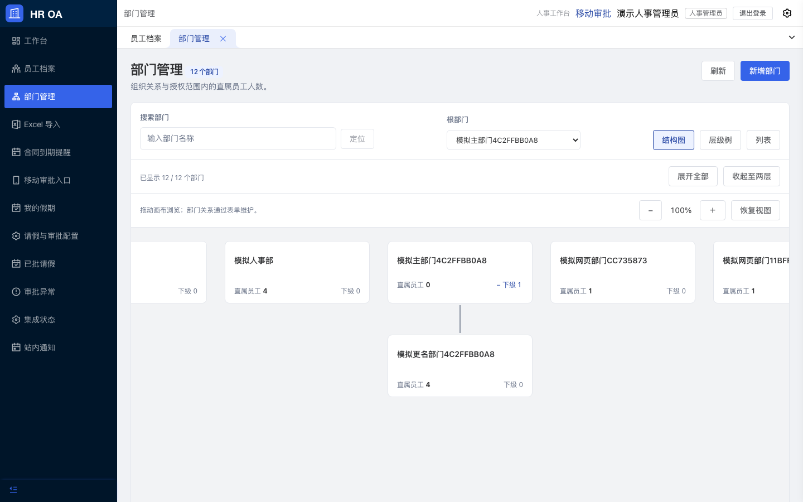
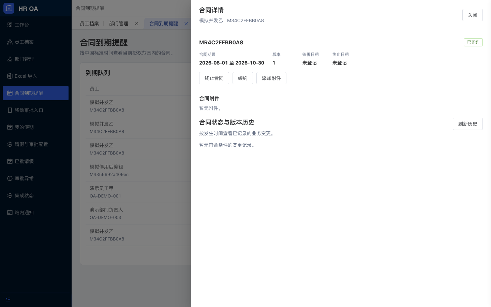
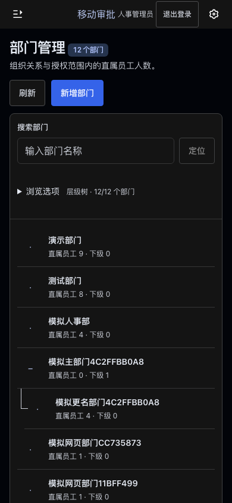

# 部门组织图与合同详情：截图与过程录像

截图来自真实本地 Chromium、现有演示/合成数据与 OA API，不是设计稿。相同角色、数据、视口、主题与动态效果条件配对。

原始逐帧数据、CDP 轨迹与最终连线复验保存在本机 `tests/results/org-contract-ux-20261108/`；公开文件清单及 SHA-256 见 [素材清单](ORG_CONTRACT_UX_ASSETS.json)。

## 部门页面

| 场景 | 修改前 | 修改后 |
| --- | --- | --- |
| department-real-default-1440x900-light | [before](assets/org-contract-ux/before/department-real-default-1440x900-light.png) | [after](assets/org-contract-ux/after/department-real-default-1440x900-light.png) |
| department-real-locate-1440x900-light | [before](assets/org-contract-ux/before/department-real-locate-1440x900-light.png) | [after](assets/org-contract-ux/after/department-real-locate-1440x900-light.png) |
| department-real-history-1440x900-light | [before](assets/org-contract-ux/before/department-real-history-1440x900-light.png) | [after](assets/org-contract-ux/after/department-real-history-1440x900-light.png) |
| department-real-default-1366x768-dark | [before](assets/org-contract-ux/before/department-real-default-1366x768-dark.png) | [after](assets/org-contract-ux/after/department-real-default-1366x768-dark.png) |
| department-real-locate-1366x768-dark | [before](assets/org-contract-ux/before/department-real-locate-1366x768-dark.png) | [after](assets/org-contract-ux/after/department-real-locate-1366x768-dark.png) |
| department-real-history-1366x768-dark | [before](assets/org-contract-ux/before/department-real-history-1366x768-dark.png) | [after](assets/org-contract-ux/after/department-real-history-1366x768-dark.png) |
| department-real-default-390x844-dark | [before](assets/org-contract-ux/before/department-real-default-390x844-dark.png) | [after](assets/org-contract-ux/after/department-real-default-390x844-dark.png) |
| department-real-locate-390x844-dark | [before](assets/org-contract-ux/before/department-real-locate-390x844-dark.png) | [after](assets/org-contract-ux/after/department-real-locate-390x844-dark.png) |
| department-real-history-390x844-dark | [before](assets/org-contract-ux/before/department-real-history-390x844-dark.png) | [after](assets/org-contract-ux/after/department-real-history-390x844-dark.png) |
| department-real-details-1440x900-light | 新增独立详情，无对应旧抽屉 | [after](assets/org-contract-ux/after/department-real-details-1440x900-light.png) |
| department-real-details-1366x768-dark | 新增独立详情，无对应旧抽屉 | [after](assets/org-contract-ux/after/department-real-details-1366x768-dark.png) |
| department-real-details-390x844-dark | 新增独立详情，无对应旧抽屉 | [after](assets/org-contract-ux/after/department-real-details-390x844-dark.png) |

## 合同原页查看

| 条件 | 修改前：员工档案中查看 | 修改后：提醒页抽屉 |
| --- | --- | --- |
| 1440x900-light-no-preference | [before](assets/org-contract-ux/before/contract-1440x900-light-no-preference.png) | [after](assets/org-contract-ux/after/contract-1440x900-light-no-preference.png) |
| 1366x768-dark-no-preference | [before](assets/org-contract-ux/before/contract-1366x768-dark-no-preference.png) | [after](assets/org-contract-ux/after/contract-1366x768-dark-no-preference.png) |
| 390x844-light-no-preference | [before](assets/org-contract-ux/before/contract-390x844-light-no-preference.png) | [after](assets/org-contract-ux/after/contract-390x844-light-no-preference.png) |
| 360x800-dark-no-preference | [before](assets/org-contract-ux/before/contract-360x800-dark-no-preference.png) | [after](assets/org-contract-ux/after/contract-360x800-dark-no-preference.png) |
| 320x740-dark-reduce | [before](assets/org-contract-ux/before/contract-320x740-dark-reduce.png) | [after](assets/org-contract-ux/after/contract-320x740-dark-reduce.png) |

## 连续过程录像

片段仅截取点击前后过程，不包含登录过程；无合成或覆盖图层。录像能看见旧版员工页面中间帧与新版原页抽屉，量化结果见[验收记录](ORG_CONTRACT_UX_VALIDATION.md)。

| 条件 | 修改前 | 修改后 |
| --- | --- | --- |
| 1440x900-light-no-preference | [before](assets/org-contract-ux/video/before-1440x900-light-no-preference.webm) | [after](assets/org-contract-ux/video/after-1440x900-light-no-preference.webm) |
| 390x844-light-no-preference | [before](assets/org-contract-ux/video/before-390x844-light-no-preference.webm) | [after](assets/org-contract-ux/video/after-390x844-light-no-preference.webm) |

## 代表画面

实体手机、Safari 和软键盘未实测；浏览器视口模拟不能代替真实设备验收。真实企业微信、OSS 和生产部署不在本轮验证范围。
