# UI/UX 同条件前后截图

2026-11-08。以下为真实 Chromium 视口截图，未经裁切、拼接或美化。页面使用本地合成数据；mock 不代表真实企业微信或 OSS 验收。

基线：`3e11a2a`；改造运行源码摘要：`a43e9a41edb7a9adf4d1cabe46f0741fea39862c`。每对角色、场景、主题、视口相同，逐张 SHA-256 见 [机器索引](assets/ui-ux/index.json)。

33 项固定业务数据指纹一致。导入预览由真实请求新建，其 ID、有效期、临时历史会不同；工作簿行和文件名相同。组织树使用各版本默认状态，手机默认收起是本次布局改动。

PC 使用最终补拍镜像；两张 H5 图保留此前完整批次的实际运行摘要，最终镜像的 7 项 H5 资源 SHA-256 与该批次一致。每张来源版本写入机器索引，不将旧图改写为新截图。

完整本地证据：`tests/results/ui-ux-20261108/PAIRS_FINAL.md`、`pairs-final.json` 与各候选目录；此处公开 9 对代表图，完整测试结果见 [验收记录](UI_UX_VALIDATION.md)。

## 桌面员工名册

角色：`hr_admin`；视口：1440×900；主题：light。

| 改造前 | 改造后 |
| --- | --- |
| 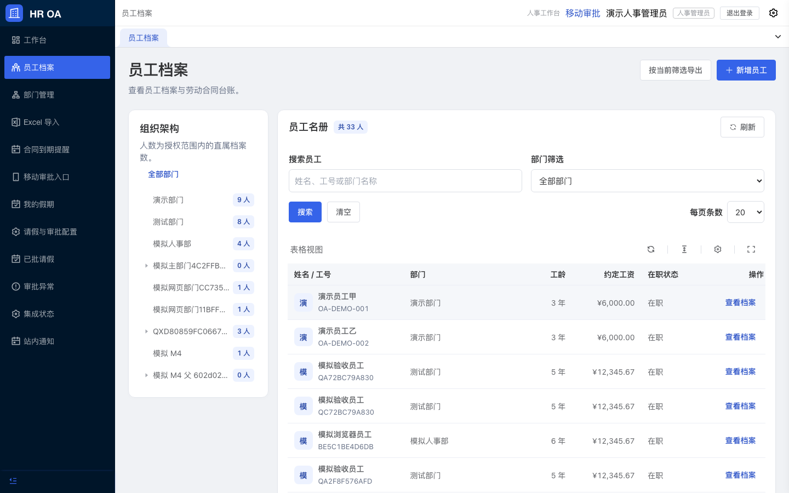 | 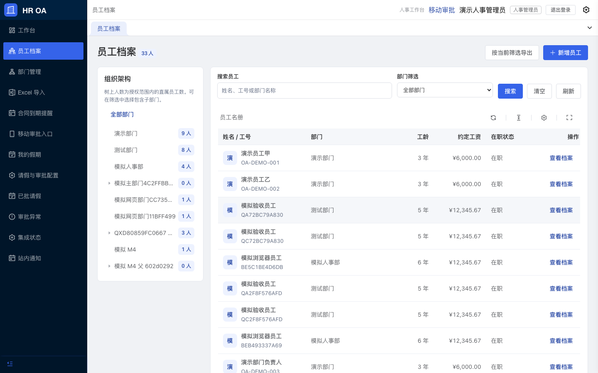 |

## 手机员工名册

角色：`hr_admin`；视口：390×844；主题：light。

| 改造前 | 改造后 |
| --- | --- |
| 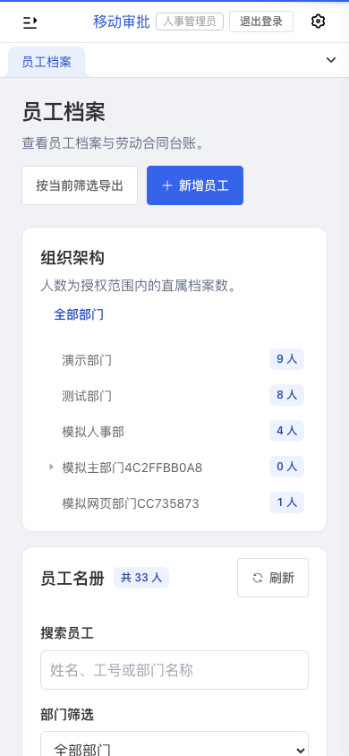 | 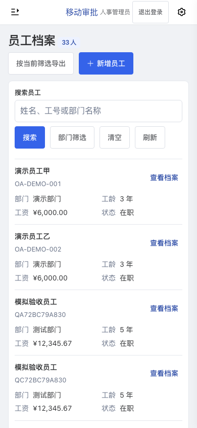 |

## 手机深色员工编辑

角色：`hr_admin`；视口：390×844；主题：dark。

| 改造前 | 改造后 |
| --- | --- |
| 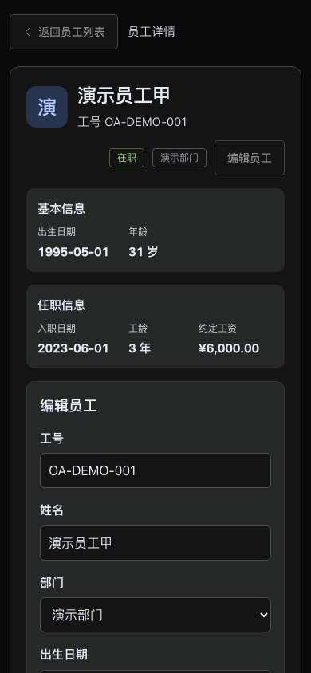 | 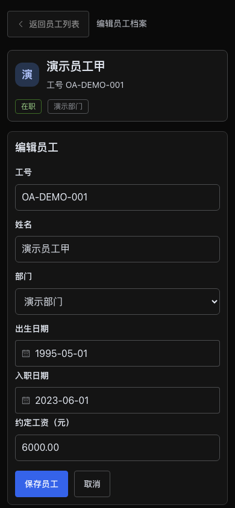 |

## 独立审批创建

角色：`employee`；视口：1440×900；主题：light。

| 改造前 | 改造后 |
| --- | --- |
| 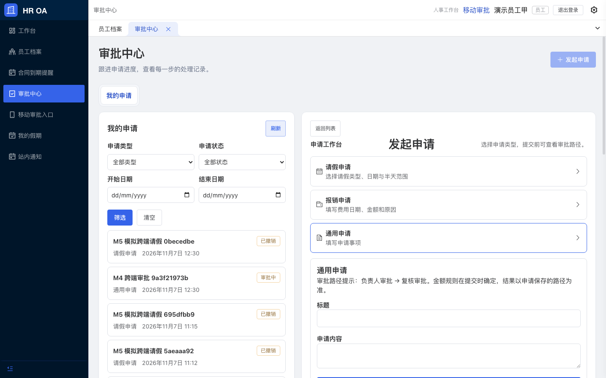 | 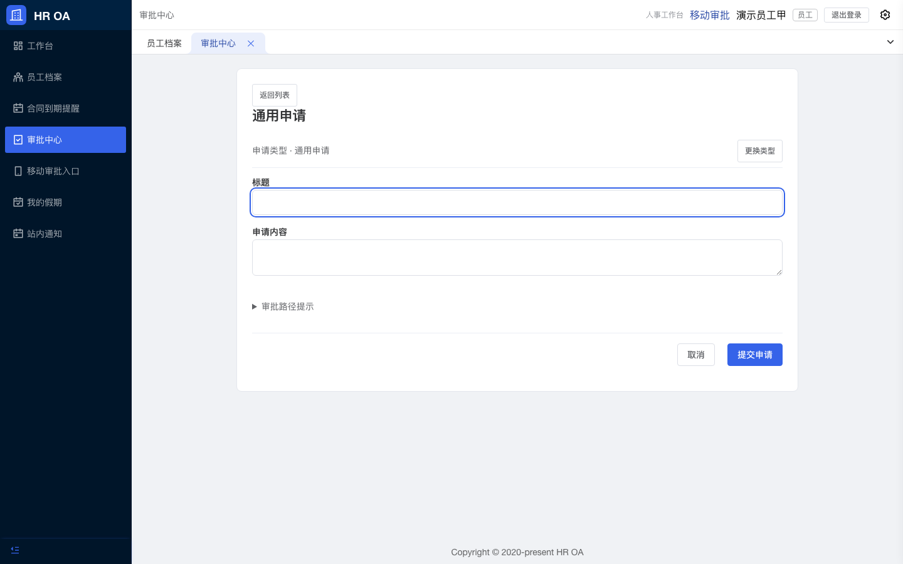 |

## H5 长表单首屏

角色：`employee`；视口：390×844；主题：light。

| 改造前 | 改造后 |
| --- | --- |
| 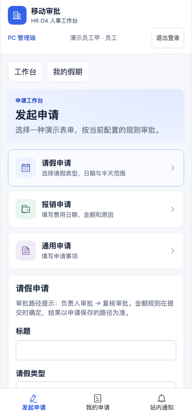 | 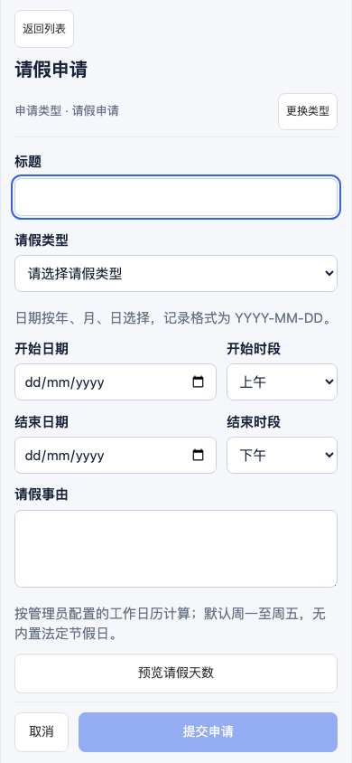 |

## 320px 深色末尾与提交

角色：`employee`；视口：320×740；主题：dark。

| 改造前 | 改造后 |
| --- | --- |
| 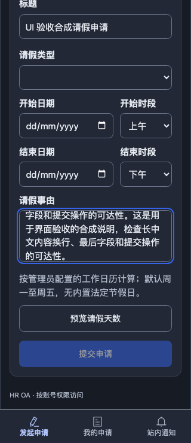 | 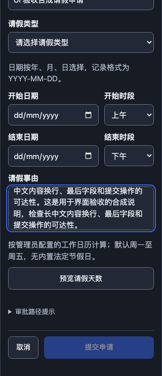 |

## 手机深色合同与附件

角色：`hr_admin`；视口：390×844；主题：dark。

| 改造前 | 改造后 |
| --- | --- |
| 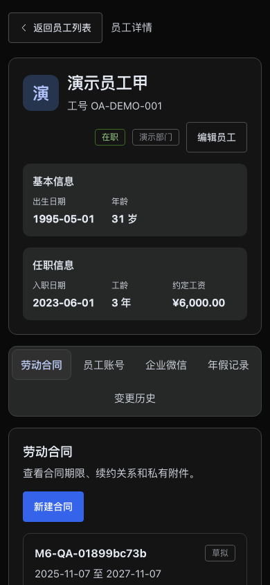 | 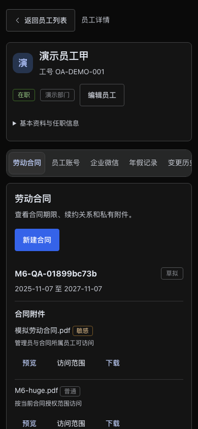 |

## 导入校验错误阶段

角色：`hr_admin`；视口：1440×900；主题：light。

| 改造前 | 改造后 |
| --- | --- |
| 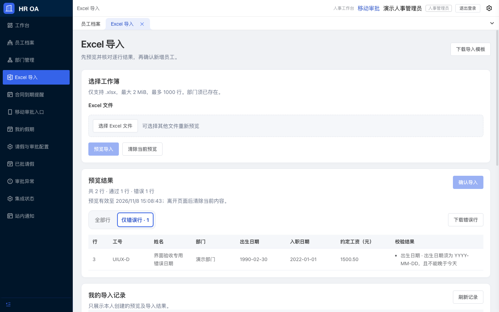 | 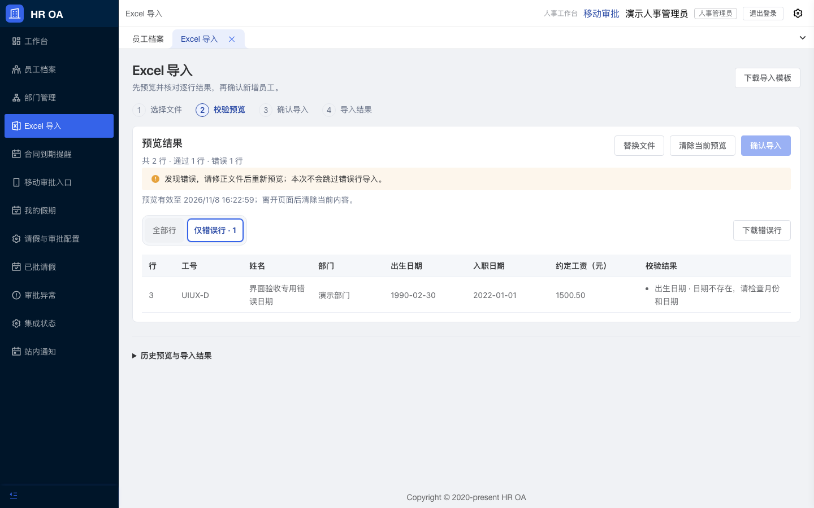 |

## 业务通知与对象

角色：`employee`；视口：1440×900；主题：light。

| 改造前 | 改造后 |
| --- | --- |
| 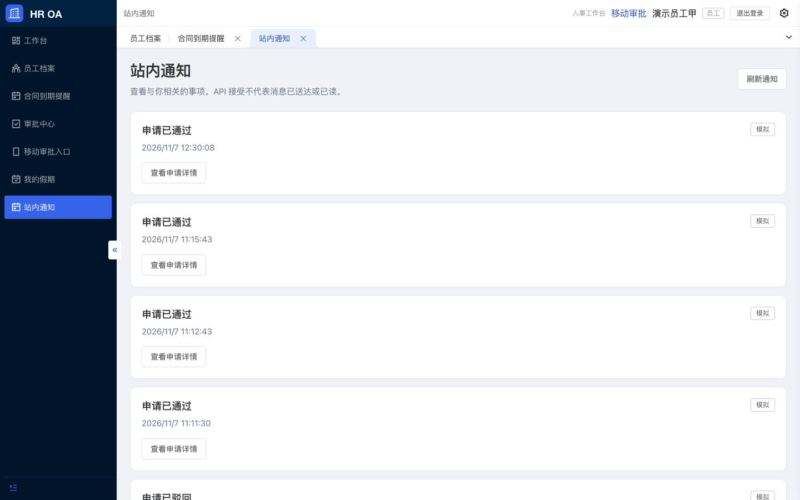 | 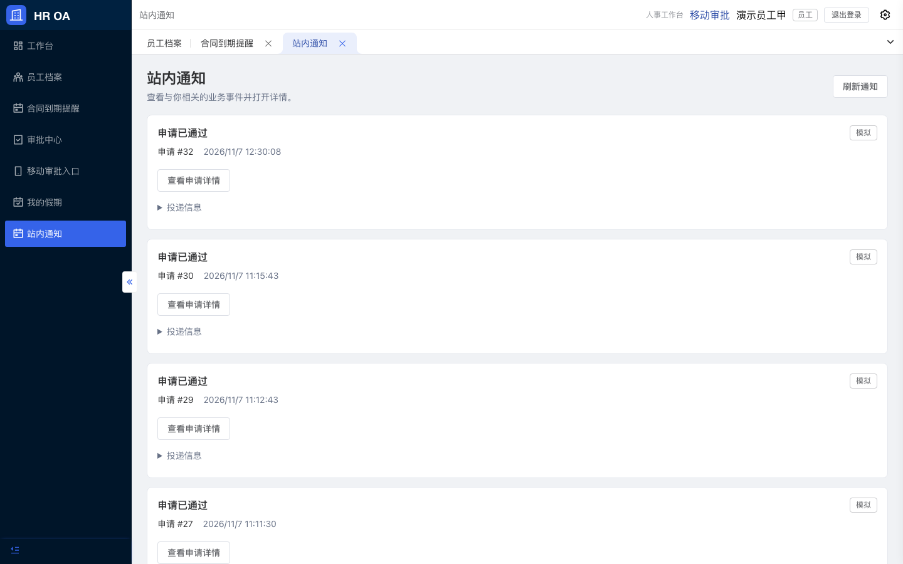 |
